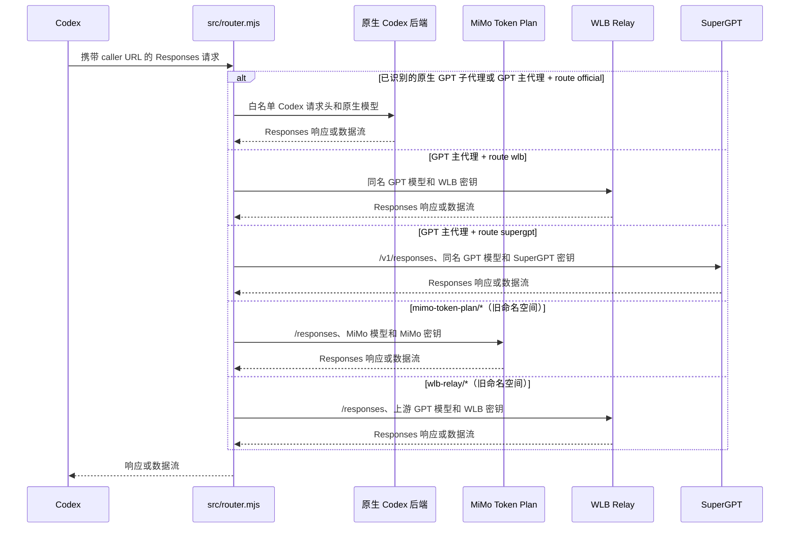

# Codex Router 工作原理

Codex Router Lite 只包含一个本地 Node 路由器。Codex 继续使用内置的 `openai`
服务商，但由路由器管理的 `openai_base_url` 指向本地路由器。默认安装不写入
`model_catalog_json`，因此 Codex 继续使用并自行更新官方模型目录。路由器根据请求
中的模型 slug、子代理元数据和全局 GPT 路由设置选择官方处理或第三方路由处理。

## 请求流程



`src/start.mjs` 监督这一个路由器子进程，并等待其健康检查通过。每次健康探针的超时
不会超过整体等待 deadline，成功响应会排空响应体以保持连接可复用；路由器对客户端连接池使用 120 秒 keep-alive，并为中途
断流写入独立的 usage 标记。收到 `SIGINT`/`SIGTERM` 时，路由器停止接收新请求，
在途请求最多 drain 2 秒；已开始的 SSE 会收到本地重启 terminal error 后 clean EOF，
尚未发送响应头的请求返回 503。`src/start.mjs` 的强杀 backstop 会覆盖 drain 和 flush
窗口；`MODEL_ROUTER_SHUTDOWN_DRAIN_MS` 可调整 drain 时长。它还为 Node 的 `fetch`
提供代理环境：启动时按候选端口探测本机代理（v2rayN `10808`/`10809` 优先，兼容
Clash `7897`/`7890`，`CODEX_ROUTER_PROXY_PORTS` 可覆盖，显式 `HTTPS_PROXY` 优先，
探测不到则原生路由直连），监督进程内的看门狗每 12 秒复测，代理在启动后才出现或
换到其他候选端口时，先写 `shutdown.request` 优雅排空再带新代理环境重启路由器子
进程（代理消失不触发重启；显式 `HTTPS_PROXY` 时看门狗停用）。请求路径中没有
网关、API 转发器、Python 进程、OAuth 流程、托盘应用或更新器。

Windows 后台服务由 `src/service-windows.mjs` 通过计划任务管理。后台启动的
`src/start.mjs` 会将监督进程 PID 原子写入 `service.pid`；停止或重启时，服务管理器
先核对 Node 可执行文件和完整的 `src/start.mjs` 命令行，再结束整个进程树。Windows
无法跨进程投递 `SIGTERM`，因此停止先写入 `shutdown.request` 触发与重启信号相同的
排空流程，等监督进程在 drain/flush 窗口内退出，超时才走强杀兜底；路由器启动时会
清理残留的请求文件，避免上次停止的遗留让新实例一启动就关闭。`start`/`restart` 会
等待 `/health` 通过后才返回就绪。旧启动器
没有 PID 文件时，只按精确的 `wscript -> cmd -> start.mjs` 父子链查找一次，避免误杀
无关的 Node 进程，也避免旧路由器继续占用 4102 端口。

## 官方目录与旧模型目录

`src/model-registry.mjs` 从 `config/` 加载三个服务商描述文件及已有模型片段，并验证
服务商 ID、带命名空间的 slug、上游模型名称和已列出的元数据。仅支持以下服务商：

| 服务商 | 基础 URL 来源 | 凭据文件 |
| --- | --- | --- |
| `mimo-token-plan` | `config/mimo/mimo.json` | `mimo-api-key.secret` |
| `wlb-relay` | `config/wlb/wlb.json` | `wlb-api-key.secret` |
| `supergpt-relay` | `config/supergpt/supergpt.json` | `supergpt-api-key.secret` |

本项目不提供模型元数据更新或静态目录生成入口，也不向 Codex 写入
`model_catalog_json`；官方模型选择器由 Codex 自己维护。设置或删除服务商密钥
仅修改凭据及服务商启用状态，不再捕获或重建模型目录。

MiMo 的两个及 WLB 的三个命名空间 slug 保留给已有目录或直接请求；原生 GPT
全局路由继续使用官方选择器中的模型名。已有的 `native-models.json` 和
`merged-models.json` 仅保留兼容读取，不会由本项目更新或自动删除。

如果仍使用本安装管理的旧目录配置，重新执行 `codex-router.ps1 enable`
（POSIX：`bin/enable`）移除该配置，再完全重启 Codex。用户自有的目录配置仍受
保护，安装器不会覆盖。

## 路由和凭据

`src/gpt-route.mjs` 将 `official`、`wlb` 或 `supergpt` 写入状态目录；文件不存在时默认使用
`official`。这是全局设置，不绑定线程，从下一次非子代理的原生 GPT 请求起对所有任务共享。使用
`wlb` 或 `supergpt` 时，`src/router.mjs` 将请求中的 `gpt-*` 模型名原样发送给对应
服务商，不依赖旧静态模型名单；SuperGPT 不新增旧命名空间模型条目。官方新增模型
无需修改 Router，模型可用性取决于上游及 API key 分组；上游不支持时返回其错误。只有 WLB
明确的额度耗尽会自动保存为 `official`，默认等待 5 秒，再以原始 Codex 身份重发
当前尚未输出的请求；后续 GPT 主代理请求也走官方。普通限流、认证失败、套餐不包含
API 和已开始输出的流不切换；没有非空官方 `Authorization` 或状态保存失败时不访问
官方。状态损坏或 owner 校验失败时停止切换并报告错误。显式 `wlb-relay/*`、MiMo
和固定官方的子代理保持原语义；额度恢复后需手动运行 `route wlb`。等待可通过
`CODEX_ROUTER_WLB_FALLBACK_DELAY_MS` 调整，接受 0 至 30000 毫秒的整数，其他值使用
默认。客户端取消会终止等待；路由器关闭后不会再向官方重发。这个等待发生在
路由器内，不修改 Codex 客户端的重连间隔；更新源码后需重启服务。正在执行的任务中途切换服务商可能带来
历史上下文兼容风险。SuperGPT 错误直接返回，不使用 WLB 专属回退或修改路由状态。
首次新增服务商配置需重启 Router，之后 `route official|wlb|supergpt` 热切换无需重启。
`route status` 只读；`--json` 仅由总状态命令支持。

对于原生 `gpt-*`，已识别的子代理固定走官方：复用 `x-openai-subagent`（忽略明确
的 `false`/`0`）、有效的 `x-codex-parent-thread-id` 或线程 rollout 中的
`source.subagent.thread_spawn`。首次请求时 rollout 缺失或首行未写完不会缓存负结果，
后续请求会重新识别；没有可识别证据时仍按主代理请求遵循全局路由。子代理固定官方
不读取全局状态，因此损坏的全局状态只阻断 GPT 主代理请求。此规则同时覆盖
`/responses`、`/responses/compact` 和 `/responses` 内以 `compaction_trigger` 触发的
压缩 v2；没有独立的 `/responses/compact/v2` 端点。WLB 额度耗尽转官方同样覆盖
这三种请求，并从原始请求重建官方请求体，保留原端点、模型、工具及官方身份，复用
原生历史清理；WLB 密钥不会带到官方。官方返回错误时直接透传，不循环切换。显式 `wlb-relay/*` 与 MiMo
命名空间路由保持原语义。

官方路由使用白名单 Codex 请求头并保留客户端 `Authorization`，将请求转发给原生
Codex 后端；GPT 主代理的 `wlb` 或 `supergpt` 路由注入对应密钥并使用同名 GPT 模型。独立的 `/alpha/search` 搜索
请求和图片请求也只会转发给原生后端，并且必须
携带非空的 `Authorization`，否则本地直接返回 `401`，不访问上游。原生 SSE
已经观察到 `response.completed` 后，即使客户端紧接着关闭连接，也按 upstream status
和 Token usage 记录，不再误记为客户端取消或 `0`；尚未完成的 native 流仍记为客户端
取消。GPT-5.6 原生请求会删除旧兼容字段 `prompt_cache_retention`，不影响
`prompt_cache_options`。当会话从第三方模型切回原生 GPT 时，路由器只保留
`encrypted_content` 符合原生 `gAAAAA...` token 形状的 reasoning，并移除仅用于
输出的 `content`；没有原生加密上下文的外部 reasoning 会整项丢弃，避免
`store=false` 请求引用并未在 OpenAI 持久化的外部 `rs_*` item。对于带命名
空间的旧 slug，它会解析服务商，将模型名替换为 `upstreamModel`，
读取对应密钥，再使用服务商的 `Authorization` 请求头直接发送
`POST <provider base URL>/responses`。Codex 的账户和安装凭据不会发送给第三方
服务商。数据流会直接透传；`/responses/compact` 使用相同的直连路径，并在需要时
生成由路由器管理的续接摘要。

`GET /models` 和 `GET /v1/models` 始终使用官方身份透传到官方上游，并保留请求查询
参数和官方完整响应元数据；WLB 和 SuperGPT 路由不会把模型列表替换成本地简化目录。没有当前
Codex 登录身份时，这两个端点返回 `401`。

上游省略 `content-type` 时，`src/sse-prefix.mjs` 会在最多 512 bytes 的前缀内识别
SSE。字段名可跨 chunk，开头允许 UTF-8 BOM、注释和空行；探测期间缓存的原始字节会
按顺序交回响应处理器。Token 用量统计和 MiMo custom tool 还原共用该判定，非 SSE
响应则保持原路径。第三方输入 Token 的兜底估算会扣除 `encrypted_content` 字符串值，
因为这些密文不是模型可见提示词；未知字段仍默认计入，保持向上估算。

MiMo 的 Responses 网关不接受 Codex 扩展的 `custom_tool_call` 和 `agent_message`。
路由器因此在 MiMo 路径上增加专属转换：custom tool 定义和历史调用以带单个
`input` 字符串参数的 function tool 上送，JSON/SSE 中对应的 function call 再还原为
custom tool 事件；普通 function tool 保持不变。标准协作 envelope 中的 `MESSAGE`
是未验收的中间进度，跨模型续接时不再回放；`FINAL_ANSWER`、`NEW_TASK`、
`FOLLOWUP_TASK` 及无法识别的类型仍保留。compact 路径应用同一规则。原生 GPT、
WLB 和 SuperGPT 不做这项 MiMo 专属裁剪或 custom-tool 映射。

第三方路由仍需回放的标准原生 `agent_message` envelope 可能只含不可由本地解开的
`encrypted_content`。路由器使用原生 Codex 后端的受控 function call 取回明文，
最多 4 路并发并按输入索引回填。明文只放在当前路由器进程的 LRU 缓存中，逻辑 TTL
为 24 小时，上限为 512 条或 8 MiB；不会主动持久化到模型目录、日志或凭据文件。
MiMo 裁掉旧 `MESSAGE` 进度后，新设备和服务重启后的首次续接通常无需解密这些
历史项；仍需解密的载荷由 4 路并发避免串行，LRU 则加速同一进程内的后续续接。

响应流连续 300 秒没有任何数据时，路由器会取消上游请求。SSE 会收到固定的
terminal error；尚未开始的非 SSE 响应会返回 504。该空闲时限可通过
`CODEX_ROUTER_STREAM_IDLE_TIMEOUT_MS` 在 10 毫秒至 15 分钟之间调整，收到每个
chunk 后都会重新计时，因此不会限制持续输出请求的总时长。

普通路由请求的第三方上游错误响应体最多读取 64 KiB；路由器会在翻译为 Codex 错误前遮盖
Bearer、token、key、secret、caller capability、查询参数和控制字符，并把错误详情
限制为短文本。可解析的 quoted JSON 字段会替换字段值而保留合法 JSON，避免凭据或
上游内部信息进入客户端响应。

服务商密钥通常保存在受保护的状态目录中（默认为
`~/.codex/codex-router/`）。`provider-key set` 会写入密钥并启用该服务商；环境
变量密钥可供前台进程使用，但后台服务不会自动继承。SuperGPT 使用 `SUPERGPT_API_KEY`
和可选的 `SUPERGPT_BASE_URL`（默认 `https://api.supergpt.dev/v1`）；macOS Keychain
服务名为 `codex-router-supergpt`。应使用 API key，网页控制台 token 不能替代。持久化凭据只从普通文件读取，
符号链接、目录和读取失败的候选会被忽略；Windows 写入会用仅含当前用户
`FullControl` 的非继承 DACL 替换现有 ACL。

请求正文超限后，路由器停止缓存新字节并排空剩余请求，客户端断开仍可中止读取。
zstd 请求异步解压，帧头声明尺寸超出解压上限时提前返回 413；没有声明尺寸的帧仍受
解码器输出上限约束，畸形数据返回 400。该机制属于防御性加固，不能视为已确认修复
Windows 原生解码器崩溃。后台凭据 ACL 与服务管理的非交互 PowerShell 调用隐藏窗口。
协作载荷 relay 和 compact 响应分别最多缓冲 4 MiB 与 32 MiB，超限会立即取消上游
流；这些限制在数据到达时执行，不会先由 `arrayBuffer()` 无界收集。

第三方普通和压缩请求共用历史规范化入口：对于缺少有效调用 ID、但具有名称和输出的
`codex_app` 工具结果，保留名称及原始输出文本（结构化输出转为 JSON），转换为可读
用户消息；不伪造调用 ID。官方请求、有调用 ID 的结果和其他命名空间保持原样。

路由器只监听回环地址，并在读取请求前检查每次安装生成的 caller 凭据。
`src/start.mjs` 设置 `NODE_USE_ENV_PROXY=1` 并将 `HTTP_PROXY`/`HTTPS_PROXY`
传递给上游 fetch。WLB/MiMo 固定 DIRECT，SuperGPT 使用现有代理环境；服务商 URL 和 TLS 行为
仍由服务商注册表及 Node 的正常 HTTPS 验证控制。

## 维护和检查

修改模型片段后验证注册表，并按改动范围运行：

```sh
node --input-type=module -e 'await import("./src/model-registry.mjs")'
node --test test/official-catalog.mjs
node --test test/router-fixes.mjs test/response-usage-hardening.mjs test/http-health-bounds.mjs test/credential-file-security.mjs test/graceful-shutdown.mjs test/upstream-hardening.mjs test/windows-service-process.mjs
node scripts-check.mjs
```

日常只读检查使用 `codex-router.ps1 status`（Windows）或
`bin/model-router codex status`（POSIX）；它只读取本地健康端点、Codex 配置、官方或
旧模型目录模式、Provider 凭据状态、安装清单和后台服务，不会自动修复或请求上游。
官方目录模式不要求静态 8 模型目录；为了兼容已有安装，旧目录状态检查仍要求
精确的 8 个目录 slug（包括 5 个路由 slug）。健康检查、受管配置、未降级的 Provider 选择以及相应凭据
满足时，退出码才为 0；否则为 1，参数错误为 2。只有总状态命令支持 `--json`，即
`status --json`；`route status` 是只读文本查询，不接受 `--json`。

Codex 会自行更新官方目录。模型片段变更仍需重启路由器才能加载；无需生成目录。

另一台设备不要复制其他设备的状态目录：仅使用官方路由时可直接运行
`.\codex-router.ps1 install`（POSIX 使用 `bin/install`）；需要第三方路由时再在本机
配置对应的 provider key，随后完全重启 Codex。
同一设备更换 checkout 时，POSIX installer 提供显式的所有权转移流程；Windows
installer 目前会拒绝 foreign state owner，应继续从原 checkout 更新或先人工解决
冲突。安装会确保本机 caller secret、配置 Codex endpoint，并登记后台服务，不会默认
写入 `model_catalog_json` 或构建静态目录。

主要文件如下：

| 文件 | 职责 |
| --- | --- |
| `src/router.mjs` | caller 验证、模型分发、原生搜索/图片、协作载荷 relay、直接转发、数据流和压缩摘要 |
| `src/mimo-custom-tools.mjs` | MiMo custom tool/agent message 的请求转换、历史裁剪和 JSON/SSE 响应还原 |
| `src/response-usage.mjs` | 从 JSON 或 SSE 响应提取 Token 用量并保持响应透传 |
| `src/sse-prefix.mjs` | 有界识别无 `content-type` 的 SSE 并保持探测字节顺序 |
| `src/gpt-route.mjs` | 读写非子代理的原生 GPT 请求的全局路由状态，默认官方路由 |
| `src/model-registry.mjs` | 加载并验证服务商和模型 |
| `src/start.mjs` | 监督一个路由器子进程并提供代理环境 |
| `src/status.mjs` | 只读汇总路由器、配置、目录模式、GPT 路由、Provider、安装和服务状态 |
| `src/service-windows.mjs` | 管理 Windows 计划任务，先优雅排空再强杀已验证的监督进程树，启动/重启等待健康检查 |
| `config/mimo/`、`config/wlb/`、`config/supergpt/` | 三个服务商的描述文件及已有模型片段 |
| `test/official-catalog.mjs` | 检查官方目录状态、旧配置迁移、多代理子表去重及密钥操作不重建目录 |
| `test/router-fixes.mjs` | 检查路由、MiMo 历史兼容、relay 并发/缓存、统计、脱敏、有界错误和流式 idle timeout |
| `test/response-usage-hardening.mjs` | 检查 split/BOM SSE、字节透传、MiMo 还原和密文 Token 估算 |
| `test/http-health-bounds.mjs` | 检查 zstd 帧头边界、请求 drain/中止、响应超限取消和健康 deadline |
| `test/credential-file-security.mjs` | 检查凭据 symlink/非文件拒绝和 Windows ACL 规范化 |
| `test/graceful-shutdown.mjs` | 检查重启 drain、SSE terminal error、503 fallback、stop 文件触发和 idle keep-alive 快速退出 |
| `test/upstream-hardening.mjs` | 检查健康响应排空、keep-alive 参数、错误 cause 链和断流 usage 标记 |
| `test/windows-service-process.mjs` | 检查 Windows PID 登记、优雅停止与进程树强杀兜底和误杀防护 |
| `test/windows-hidden-consoles.mjs` | 检查后台子进程隐藏窗口及交互输入保持可见 |
